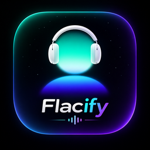
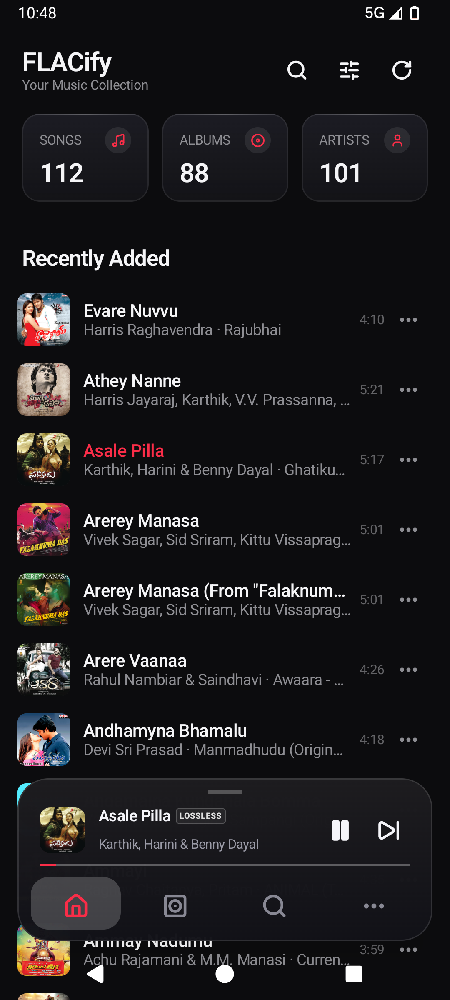
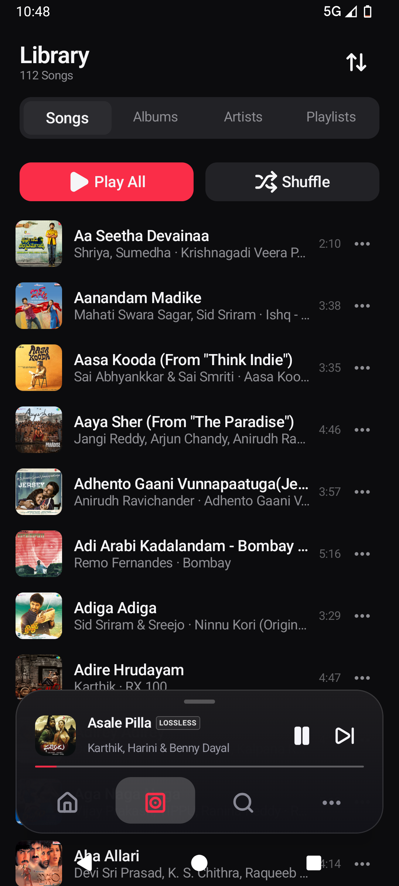
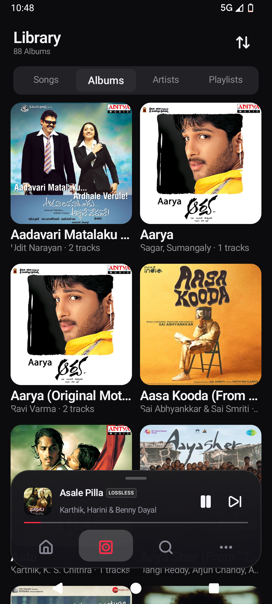
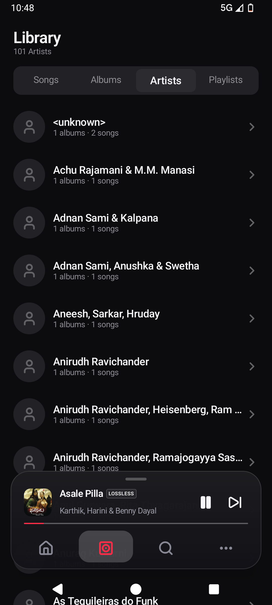
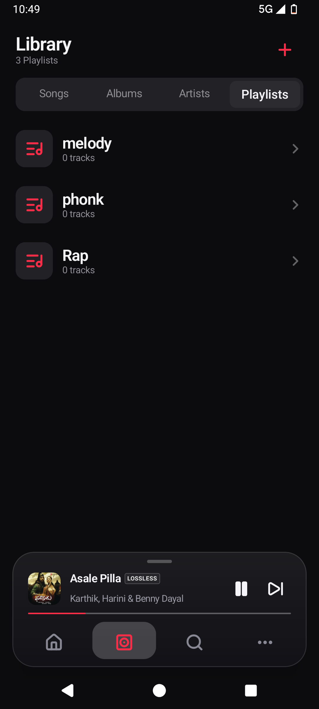
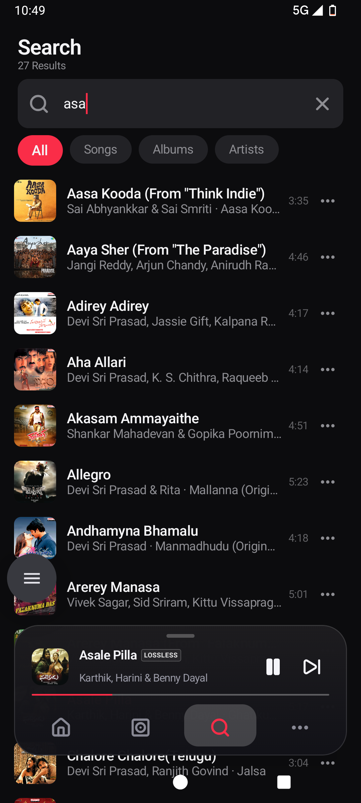
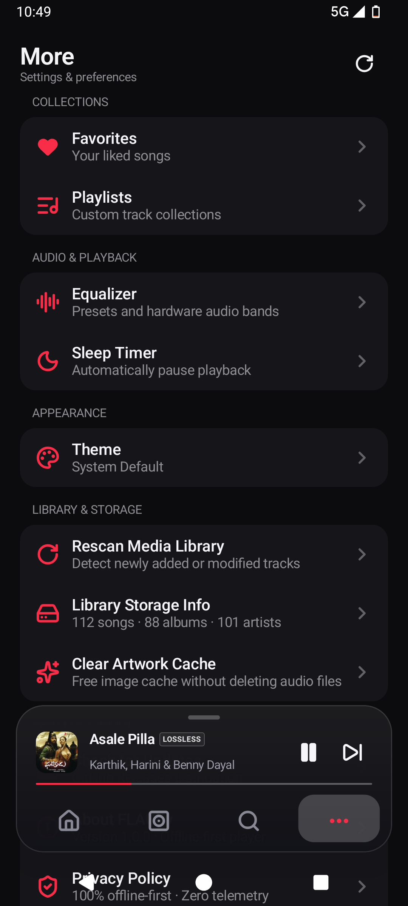

<div align="center">



# FLACify

### Audiophile-Grade Local Music Player for Android

[-3DDC84?style=flat-square&logo=android&logoColor=white)](https://developer.android.com)
[](https://kotlinlang.org)
[](https://developer.android.com/jetpack/compose)
[](https://developer.android.com/media/media3)
[](LICENSE)

*An uncompromising, modern offline music player engineered for high-resolution lossless audio, fluid physics-based gestures, and zero-layout-shift elegance.*

</div>

---

## 📱 Interface Showcase

<div align="center">

| Home | Songs | Albums | Artists |
|:---:|:---:|:---:|:---:|
|  |  |  |  |

<br/>

| Playlists | Search | Settings |
|:---:|:---:|:---:|
|  |  |  |

</div>

---

## ✨ Key Features

- **Bit-Perfect Lossless & Hi-Res Audio Engine**: Decoupled background playback service powered by AndroidX Media3 (`ExoPlayer` + `MediaSessionService`). Full support for FLAC, ALAC, WAV, AAC, and MP3.
- **Zero-Layout-Shift Now Playing Experience**: Locked layout constraints prevent jarring jumps during song transitions. Dynamic palette background tinting adapts seamlessly to album artwork with WCAG AA contrast compliance.
- **High-Precision Scrubber & Lossless Badges**: Sub-millisecond seeking controls paired with authentic audio quality badges and waveform indicators.
- **Instant Up Next Capsule**: Glanced queue preview right from the playback view with fixed-geometry pills and full queue reordering.
- **High-Performance Library Scaling**: Powered by Room SQLite and Paging 3, delivering sub-250ms cold starts and effortless indexing for 50,000+ tracks.
- **Synchronized Karaoke Lyrics**: Millisecond-accurate `.lrc` timestamp parsing with automatic auto-scroll tracking.
- **Hardware-Accelerated Audio FX**: 5-band parametric equalizer, bass boost, and audio virtualizer presets.
- **Monotonic Sleep Timer**: Non-drifting monotonic countdown clock with gentle audio fade-out and system notifications.
- **Edge-to-Edge Fluid Navigation**: Floating capsule dock decoupled from bottom bar insets, with native gesture-nav and 3-button navigation support.

---

## 🛠️ Architecture & Tech Stack

```
FLACify
├── app/src/main/java/com/flacify/music/
│   ├── core/
│   │   ├── audio/          # MediaSessionService, ExoPlayer, Equalizer, SleepTimer
│   │   ├── data/           # Repositories, MediaStore scanner, LRC parser
│   │   ├── database/       # Room database, DAOs, Entity models
│   │   ├── designsystem/   # Themes, semantic colors, shapes, typography, icons
│   │   ├── model/          # Pure domain models (Song, Album, Artist, PlaybackState)
│   │   └── ui/             # Reusable UI primitives (HighPrecisionScrubber, MarqueeText)
│   └── feature/
│       ├── home/           # Library dashboard & stat overview
│       ├── library/        # Lazy-paged Songs, Albums, Artists, Playlists
│       ├── nowplaying/     # Immersive player, dynamic palette, Up Next queue
│       ├── search/         # Debounced FTS/indexed multi-entity search
│       ├── lyrics/         # Real-time LRC synchronized scrolling
│       ├── equalizer/      # 5-band EQ controls & audio effects
│       ├── timer/          # Monotonic sleep timer sheet
│       └── more/           # Settings, diagnostics & OTA updates
```

| Layer | Technology |
|---|---|
| **Language** | Kotlin 2.0.21 (Java 21 toolchain) |
| **UI Framework** | Jetpack Compose + Material Design 3 |
| **Audio Core** | AndroidX Media3 1.5.0 (`media3-exoplayer`, `media3-session`) |
| **Database & Cache** | Room 2.6.1 + SQLite Paging 3 + DataStore Preferences |
| **Dependency Injection** | Dagger Hilt 2.51.1 |
| **Image Loading** | Coil 3.0.4 |
| **Concurrency** | Kotlin Coroutines & Reactive StateFlows |
| **Optimizer** | ProGuard / R8 with Resource Shrinking |

---

## 🚀 Building & Running

### Prerequisites
- **JDK 21** or higher
- **Android SDK** with platform 35 (`compileSdk = 35`, `minSdk = 29`)

### 1. Clone the repository
```bash
git clone https://github.com/santjsx/Flacify.git
cd flacify
```

### 2. Run unit tests
```bash
./gradlew testDebugUnitTest
```

### 3. Build Debug APK
```bash
./gradlew assembleDebug
# Output: app/build/outputs/apk/debug/app-debug.apk
```

### 4. Build Optimized Release APK
```bash
./gradlew assembleRelease
# Output: app/build/outputs/apk/release/app-release.apk (approx. 6.9 MB)
```

---

## 📄 License

```
Copyright 2026 FLACify Contributors

Licensed under the Apache License, Version 2.0 (the "License");
you may not use this file except in compliance with the License.
You may obtain a copy of the License at

    http://www.apache.org/licenses/LICENSE-2.0
```
